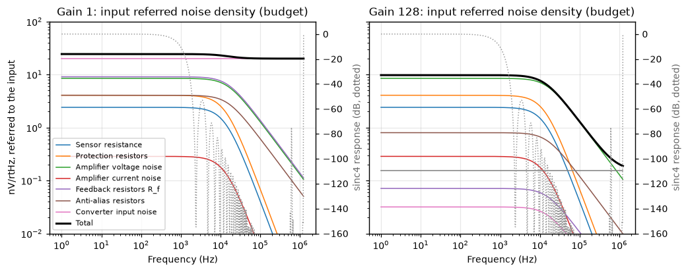

# emb-mixed-signal-daq

A precision 24-bit data acquisition channel designed noise budget first:
specification, then a hand calculated noise budget, then the analogue front
end, a behavioural sigma-delta converter, STM32 class firmware and a
calibration routine. **Everything is simulated. No board has been built**, so
every number below comes from a model and is labelled as such; the bench
steps that would replace them are listed in [STATUS.md](STATUS.md).

[](https://github.com/CGainsWorks/emb-mixed-signal-daq/actions/workflows/ci.yml)

```mermaid
flowchart LR
    subgraph Analogue front end
        S[Sensor or<br/>calibrator] --> SEL[Input selector<br/>signal, short, reference]
        SEL --> EMI[Protection and<br/>EMI filter]
        EMI --> G[Two amplifier<br/>gain stage<br/>G = 1, 8, 32, 128]
        G --> AA[Anti-alias<br/>RC filter]
    end
    AA --> ADC[24-bit sigma-delta<br/>4th order, OSR 256<br/>sinc4, 2400 SPS]
    REF[2.5 V reference<br/>and RC filter] --> ADC
    ADC -- SPI --> FW[Firmware<br/>driver, sampling engine,<br/>calibration, framing]
    FW -- framed stream --> HOST[Host tools<br/>capture, ENOB, SNR,<br/>INL, noise floor]
```

How each block is made checkable without hardware:

| Block | Model | Independent check, run in CI |
|---|---|---|
| Specification | [docs/spec.md](docs/spec.md), generated from [spec.py](model/daqmodel/spec.py) | Every other result is judged against it |
| Noise budget | A closed form transfer function per contributor: [noise_budget.md](hardware/docs/noise_budget.md) | ngspice `.noise` on a deck generated from the same netlist must agree to 1 part in 10,000 |
| Front end | [ngspice decks](hardware/spice) and a [KiCad 8 schematic](hardware/kicad) ([PDF](hardware/outputs/schematic.pdf)) | The schematic is parsed back and its connectivity compared with the simulated netlist; KiCad ERC reports no errors or warnings |
| Converter | Behavioural 1-bit modulator, sinc4 decimator, thermal and reference noise, INL: [sigma_delta.py](model/daqmodel/sigma_delta.py) | Simulated noise floor against the budget; SNR against the budget's prediction |
| Firmware | C11 driver for an AD7124-8 class register map, sampling engine, calibration and host link: [firmware](firmware) | Unit tests against a mocked SPI device under address and undefined behaviour sanitisers; a firmware in the loop run on the model's codes, bit for bit against the Python reference |
| Calibration | Two point, integer arithmetic, against a simulated calibrator and reference DMM | Error after calibration at eleven points per gain against the simulated DMM |

## Results (simulated)

<!-- headline:start (generated by scripts/run_all.py; do not edit) -->
| Result (all simulated) | Value | Target |
|---|---|---|
| Noise, gain 1, 2400 SPS | 0.601 uV rms (23.0 effective bits) | 0.75 uV |
| Noise, gain 128 | 0.234 uV rms | 0.30 uV |
| Noise budget, gain 1 / gain 128 | 0.644 / 0.230 uV rms | |
| SNR, -1 dBFS sine, gain 1 | 127.4 dB | 120 dB |
| THD | -118.5 dB | -110 dB |
| ENOB | 19.31 bits | 19 bits |
| INL, best fit | 1.24 ppm of FSR | 5 ppm |
| Worst error after calibration, all gains | 4.84 ppm of FSR | 10 ppm |
<!-- headline:end -->

Full tables, plots and method: [docs/validation_report.md](docs/validation_report.md).
Where the noise comes from at each gain:



## Who would use this

The design is a reference channel for anyone who has to digitise a slow or
low frequency differential voltage to about 20 effective bits and prove it:

* **Battery and energy storage OEMs.** Cell voltage and shunt current
  measurement in a battery management or test system, where accuracy after
  calibration matters more than speed and the calibration has to be
  traceable to a reference instrument.
* **Test and measurement and industrial sensing.** Load cells, pressure
  bridges and strain gauges: the budget is written for a 350 ohm bridge and
  gain 128 resolves well under a microvolt.
* **Biopotential research front ends.** sEMG sits inside the 500 Hz band;
  the same budget method sizes an electrode front end before any part is
  ordered.

What a buyer gets is less the board than the method: a budget that was
fixed before the design and is checked against a circuit simulator on every
push, firmware whose normal and failure paths run in host tests and a
calibration routine whose arithmetic is identical on the host and the target.

## Sibling projects that would consume it

* [emb-drone-flight-stack](https://github.com/CGainsWorks/emb-drone-flight-stack):
  battery voltage and current sensing. Its firmware scales a divider into the
  microcontroller's own ADC; this channel is the precision alternative for
  pack monitoring and for characterising the divider it relies on.
* [emb-neurotech-prosthetic-arm](https://github.com/CGainsWorks/emb-neurotech-prosthetic-arm):
  the sEMG front end. Its noise analysis and this budget use the same
  method; this channel's gain 128 range and 500 Hz bandwidth cover the
  sEMG band.
* [emb-multirail-smps](https://github.com/CGainsWorks/emb-multirail-smps):
  would supply the analogue and digital rails.
* [sw-iot-telemetry-platform](https://github.com/CGainsWorks/sw-iot-telemetry-platform):
  a destination for captured datasets from the host link.

## Running it

Everything runs from one command on a Linux machine with Python 3.10 or
later, gcc and (optionally) ngspice:

```bash
./scripts/run_demo.sh
```

Or step by step:

```bash
make setup     # Python packages
make demo      # regenerate every result, then the firmware in the loop run
make test      # Python tests and the firmware unit tests
make spice     # ngspice cross-check of the noise budget
make check     # committed results match a fresh run
```

`make ci` runs exactly what GitHub Actions runs. The host tools work on a
recording of the firmware's framed stream, which `make demo` leaves in
`build/fil`:

```bash
python host-tools/capture.py build/fil/g1_stream.bin --gain 1 --out capture.csv
```

```bash
python host-tools/analyse.py capture.csv --gain 1 sine --cycles 67
```

## Repository layout

| Path | Contents |
|---|---|
| [docs/](docs) | Specification, validation report, calibration procedure |
| [hardware/docs/](hardware/docs) | Noise budget, grounding strategy, routing notes |
| [hardware/spice/](hardware/spice) | ngspice decks, one per gain, generated |
| [hardware/kicad/](hardware/kicad) | KiCad 8 project: schematic and symbol library, generated |
| [hardware/outputs/](hardware/outputs) | Bill of materials, schematic PDF and SVG, ERC report |
| [model/daqmodel/](model/daqmodel) | Specification, front end, budget, converter model, generators |
| [firmware/](firmware) | C11 sources, host mock of the converter, unit tests, firmware in the loop runner |
| [host-tools/](host-tools) | Capture tool, analysis CLI, metrics, calibration reference, frame decoder |
| [test-results/](test-results) | Simulated noise floor, ENOB and SNR, linearity, calibration |
| [scripts/](scripts) | `run_all.py`, `run_fil.py`, `run_ngspice.py`, the outputs check |

## Limitations

* **Nothing is measured.** All results are simulations of a design that has
  not been fabricated. They show the design, the measurement methods and the
  firmware are consistent with each other; they cannot show a board meets
  the specification.
* **The amplifier, converter and reference noise figures are allowances**,
  not datasheet values. The gain stage is assumed to be zero drift. Part
  selection has to meet them.
* **The converter model is behavioural.** No integrator leakage, capacitor
  mismatch, sampling kickback, 1/f noise, temperature drift or settling. Its
  INL is an assumption, so the linearity result tests the measurement, not a
  part.
* **The driver has never touched a real AD7124-8.** The register map and
  timing follow the public datasheet as understood and are exercised only
  against a mock that implements the same map.
* **Layout does not exist.** The grounding and routing documents are design
  intent. There is no PCB, no Gerbers and no 3D model.
* **Common mode rejection, EMC and thermal behaviour are not modelled.**

## Licence

[MIT](LICENSE).
